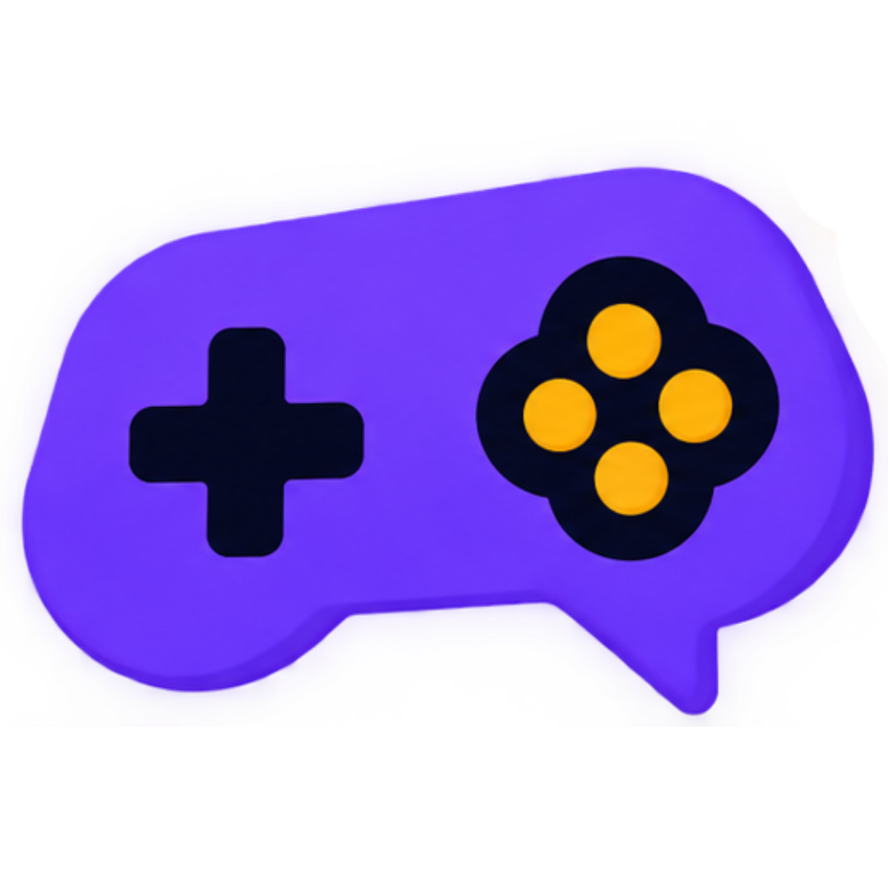

<p align="center">
  
</p>

<h1 align="center">PlayEngGround 🎮</h1>

<p align="center">
  <b>İngilizceyi ezberleyerek değil, eğlenerek refleks haline getirin!</b><br>
  Modern, dokunsal (tactile) arcade mekanikleriyle donatılmış açık kaynaklı İngilizce öğrenme platformu.
</p>

<p align="center">
  <a href="https://playengground.online"></a>
  
  
  
  
</p>

---

## 🌟 Proje Hakkında

**PlayEngGround**, geleneksel ve sıkıcı kelime ezberleme yöntemlerini bir kenara bırakıp; ses, ritim, refleks ve hızlı karar verme dinamikleriyle İngilizceyi kalıcı hale getirmeyi amaçlayan **açık kaynaklı** bir web & mobil eğitim oyun alanıdır.

Tüm oyunlar; CEFR seviyelerine göre filtrelenebilir, Hata Bankası (Mistake Bank) ile entegre çalışır ve hem dar mobil ekranlarda (9:16) hem de geniş masaüstü pencerelerde kusursuz duyarlı (responsive) bir deneyim sunar.

---

## 🕹️ İçerdiği Oyunlar

Platformda şu anda **15 farklı eğitici arcade oyun** bulunmaktadır:

| Oyun | Kategori & Odak | Açıklama |
| :--- | :--- | :--- |
| 🎧 **Sound Catch** | *Listening & Phonics* | Telaffuzu dinle; 370'ten fazla kafiyeli, sesteş ve minimal çiftten doğru olanı yakala! |
| 🧲 **Collocation Magnet** | *Collocations* | "MAKE mi DO mu?" Boşluğa uyan doğru fiile kartı fırlat veya kaydır. |
| 💣 **Word Defuser** | *Spelling & Vocab* | Süre dolmadan doğru kabloyu keserek bombayı imha et. |
| 🚀 **Phrasal Rocket** | *Phrasal Verbs* | Doğru edatla (preposition) rokete yakıt sağla, gökyüzüne fırla. |
| 🪢 **Hangman** | *Vocabulary* | Harfleri tahmin et, kelimeyi tamamla ve adamı kurtar. |
| 🃏 **Memory Match** | *Memory & Meaning* | İngilizce ve Türkçe kart çiftlerini en az hamlede eşleştir. |
| 🟩 **Word Guess (Wordle)**| *Word Puzzle* | 6 denemede 5 harfli gizli kelimeyi renk ipuçlarıyla bul. |
| 🔗 **Word Chain** | *Word Association* | Son harften yeni kelime türeterek kelime zincirini uzat. |
| 🎯 **Meaning Sniper** | *Speed & Meaning* | Hedefteki Türkçe karşılığı süre bitmeden nişan alıp vur. |
| ☠️ **Category Trap** | *Classification* | Kelime kategoriye ait mi? Kapan kapanmadan doğru kararı ver. |
| 🔀 **Sentence Scramble**| *Grammar & Syntax* | Karışık kelimeleri gramer kurallarına uygun doğru sıraya diz. |
| 🔍 **Word Detective** | *Spelling & Deduction*| Harf ve anlam ipuçlarını birleştirerek gizemli kelimeyi çöz. |
| 🔭 **Word Hunt** | *Word Search* | Harf ızgarasında gizlenen tematik kelimeleri avla. |
| 🚗 **Idiom Driver** | *Idioms* | Pistte engellerden kaçarak ve deyimleri tamamlayarak ilerle. |
| ⚽ **Word Penalty** | *Vocab & Reflex* | Kaleciyi ters köşeye yatıracak doğru kelimeyi seçip golü at. |

---

## 🚀 Öne Çıkan Özellikler

- 🔊 **Web Speech & TTS Entegrasyonu:** Doğal İngilizce telaffuz desteği ve dinleme pratikleri.
- 🧱 **3D Tactile (Dokunsal) Tasarım:** Abartılı parlamalardan uzak, solid koyu renkler ve fiziksel derinlik hissi veren kart/buton stilleri.
- 📱 **Mobil & Masaüstü Çift Ekran Uyumu:** 320px küçük mobilden 1920px geniş masaüstüne kadar sıfır taşma, dengeli yerleşim ve akıcı klavye kısayolları (`Space`, `1-4`, `A-D`, `ESC`).
- 🧠 **Kişisel Hata Bankası (Mistake Bank):** Yanıldığınız kelimeler otomatik kaydedilir; istediğiniz zaman sadece hatalarınızdan oluşan özel pratik turları başlatabilirsiniz.
- 🔥 **Günlük Seri (Daily Streak) & İstatistikler:** Düzenli çalışmayı teşvik eden motivasyon ve oturum analizleri.
- 📲 **PWA Desteği:** Masaüstü veya telefona tek dokunuşla tam ekran uygulama (PWA) olarak kurulabilir.

---

## 🛠️ Kurulum ve Yerel Çalıştırma

Projeyi yerel ortamınızda çalıştırmak için:

1. **Depoyu klonlayın:**
   ```bash
   git clone https://github.com/ardacosgn00/playengground.git
   cd playengground
   ```

2. **Bağımlılıkları yükleyin:**
   ```bash
   flutter pub get
   ```

3. **Geliştirme sunucusunu başlatın:**
   ```bash
   flutter run -d chrome
   ```

4. **Testleri çalıştırın:**
   ```bash
   flutter test
   ```

---

## 📄 Lisans ve Geliştirme

Bu proje kişisel bir açık kaynak projesidir ve **Arda Coşgun** tarafından bağımsız olarak geliştirilmektedir. Kodlar şeffaflık, eğitim ve inceleme amacıyla herkese açıktır ([MIT Lisansı](LICENSE)). Dışarıdan Pull Request (katkı) kabul edilmemektedir; geri bildirim veya önerileriniz için doğrudan iletişime geçebilirsiniz.

---

<p align="center">
  Geliştirici: <b>Arda Coşgun</b> • <a href="https://ardacosgun.web.app">Portföy</a> • <a href="https://playengground.online">PlayEngGround Canlı Sürüm</a>
</p>
